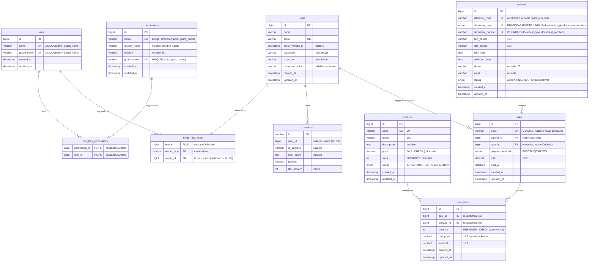

# Diagrama entidad-relación

Generado a partir de las migraciones reales de `database/migrations/`. Incluye las tablas propias del sistema y las tablas de spatie/laravel-permission que se usan (equipos/`teams` desactivado en `config/permission.php`).

Notación: **PK** clave primaria, **FK** clave foránea, **UK** restricción única. Las restricciones `CHECK` y las únicas compuestas se indican en el comentario de la columna.

## Relaciones

| Relación | Cardinalidad | Explicación |
|---|---|---|
| `roles` — `role_has_permissions` — `permissions` | N:M | Un rol agrupa varios permisos y un permiso puede estar en varios roles. Si se borra un rol o permiso, se borran sus asignaciones (`cascadeOnDelete`). |
| `users` — `model_has_roles` — `roles` | 1 usuario : 1 rol | La tabla de Spatie admite varios roles, pero el sistema asigna siempre uno con `syncRoles([$rol])` (RN-01). Es polimórfica (`model_type`, `model_id`), por eso no tiene FK hacia `users`. |
| `users` — `sessions` | 1:N | Con `SESSION_DRIVER=database`, cada sesión abierta es una fila; `user_id` queda en null hasta el login. Solo tiene índice, no FK. |
| `patients` — `sales` | 1:N | Un paciente puede tener muchas ventas. `restrictOnDelete`: no se puede borrar un paciente con ventas (RN-06). |
| `users` — `sales` | 1:N | El vendedor es el usuario autenticado que confirmó la venta (RN-10). `restrictOnDelete`. |
| `sales` — `sale_items` | 1:N (mínimo 1) | Cabecera y detalle se guardan en la misma transacción (RN-13); la aplicación exige al menos una línea (RN-08). |
| `products` — `sale_items` | 1:N | Cada línea guarda `unit_price` y `subtotal` del momento de la venta, para que un cambio de precio no altere ventas pasadas (RN-10). `restrictOnDelete`. |

## Tablas no incluidas en el diagrama

- `model_has_permissions` (Spatie): existe, pero no se usa; los permisos se asignan solo a roles.
- `password_reset_tokens`: creada por la migración base de Laravel; no se usa (no hay recuperación de contraseña).
- `cache`, `cache_locks`, `jobs`, `job_batches`, `failed_jobs`: infraestructura de Laravel.
